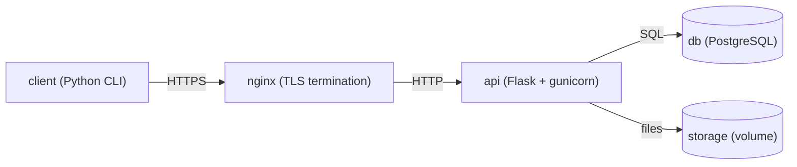

# File Manager - защищённый файловый менеджер

Клиент-серверное приложение для управления файлами с акцентом на безопасность. Закрывает типовые уязвимости из CWE: SQL-инъекции, path traversal, XXE, zip-slip, перебор паролей, cleartext-трафик, слабое хеширование и др.

## Архитектура



- **client** - консольный Python-CLI, работает через HTTP API
- **nginx** - TLS-терминация, реверс-прокси, заголовки безопасности
- **api** - Flask + gunicorn, вся бизнес-логика
- **db** - PostgreSQL 16
- **cert-init** - одноразовый контейнер, генерирует self-signed сертификаты

## Требования

- Docker Desktop (Windows/Mac) или Docker + Docker Compose (Linux)
- Свободный порт `8443` на хосте

## Быстрый старт

```bash
# 1. Клонировать репозиторий
git clone <repo> && cd <repo>

# 2. Создать папку для загрузки файлов с хоста
mkdir -p ./client/uploads

# 3. Собрать и поднять всё, кроме клиента
docker compose up -d --build

# 4. Дождаться, пока все сервисы станут healthy
docker compose ps

# 5. Запустить клиент в интерактивном режиме
docker compose run --rm client
```

## Первый запуск

В клиенте:

```
=== Файловый менеджер (вход) ===
1. Войти
2. Зарегистрироваться
0. Выход
```

Выберите `2`, создайте учётную запись (username 3–50 символов, пароль ≥ 8 символов), затем войдите под ней.

## Команды клиента

| № | Команда | Описание |
|---|---|---|
| 1 | Список дисков | Информация о накопителях |
| 2 | Мои файлы | Список файлов пользователя |
| 3 | Создать файл | `.json`/`.xml` - с валидацией; остальное - текст |
| 4 | Загрузить файл с ПК | Из папки `./client/uploads` на хосте |
| 5 | Прочитать файл | Бинарные показываются как `[двоичный файл, N байт]` |
| 6 | Обновить файл | Перезапись с валидацией формата |
| 7 | Удалить файл | - |
| 8 | Создать ZIP | Из указанных файлов |
| 9 | Распаковать ZIP | С защитой от zip-slip |
| 10 | Журнал аудита | Только свои действия |
| 0 | Выход | - |

## Загрузка файлов с хоста

Файлы из папки `./client/uploads` на хосте доступны клиенту как `/uploads/...`. Пример:

```powershell
# Windows PowerShell
echo '{"from": "host"}' > client\uploads\config.json
```

В клиенте:
```
Выберите команду: 4
Путь к локальному файлу: /uploads/config.json
Путь на сервере: docs/config.json
```

## Проверка безопасности

```bash
# SQL-инъекция: логин "alice' OR '1'='1" → 401
# Path traversal: путь "../../etc/passwd" → 400
# Чужие файлы: пользователь B не видит файлы A → 404
# Rate limit: 5 неудачных попыток с одного IP → 429
# Lockout: см. таблицу login_attempts

# Проверить HTTPS:
curl -k https://localhost:8443/api/health
```

## Сборка после изменений

```bash
# Пересобрать только api
docker compose up -d --build api

# Пересобрать только клиент (и запустить)
docker compose build client && docker compose run --rm client

# Пересобрать всё
docker compose up -d --build
```

## Полный сброс

```bash
# Удалить контейнеры, volume, сертификаты, БД
docker compose down -v
docker compose up -d --build
```

Volume `fm_pgdata` (БД) и `fm_storage` (файлы пользователей) будут пересозданы с нуля.

## Просмотр логов

```bash
docker compose logs -f api        # сервер
docker compose logs -f nginx      # reverse-proxy
docker compose logs db            # БД
docker compose logs cert-init     # генерация сертификатов
```

## Доступ к БД

```bash
docker compose exec db psql -U fm_user -d filemanager

# Полезные запросы:
\dt                                                  -- список таблиц
SELECT * FROM users;                                 -- пользователи
SELECT * FROM files ORDER BY created_at DESC;        -- файлы
SELECT * FROM operations ORDER BY timestamp DESC;    -- аудит
SELECT * FROM login_attempts ORDER BY id DESC;       -- rate limit
```


## Применённые защиты (CWE)

| CWE | Уязвимость | Где закрыта |
|---|---|---|
| CWE-89 | SQL-инъекция | параметризованные запросы в `db.py` |
| CWE-916 | Слабое хеширование | bcrypt cost 12 в `auth.py` |
| CWE-307 | Перебор паролей | rate limit по IP, `login_attempts` |
| CWE-204 | User enumeration | фиктивный bcrypt, единый ответ |
| CWE-319 | Cleartext transmission | HTTPS через nginx |
| CWE-22 | Path traversal | `_safe_path` + домашние директории |
| CWE-22 | Zip-slip | проверка каждого элемента в `archive.py` |
| CWE-611 | XXE | `lxml` с `resolve_entities=False` |
| CWE-776 | Billion Laughs | `huge_tree=False` |
| CWE-502 | Unpickle | только `json`/`lxml` |
| CWE-639 | Доступ к чужим файлам | `_owned_file_id` + изоляция по `<user_id>` |
| CWE-352 | CSRF | Bearer-токен в заголовке, не в cookie |
| CWE-209 | Утечка через ошибки | единый `@app.errorhandler` |

## Остановка

```bash
# Мягкая (volume сохраняются)
docker compose down

# Полная (volume удаляются)
docker compose down -v
```