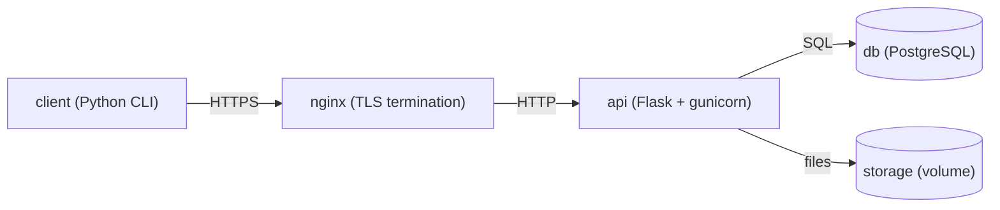

# File Manager - защищённый файловый менеджер

Клиент-серверное приложение для управления файлами с акцентом на безопасность. Закрывает типовые уязвимости из CWE: SQL-инъекции, path traversal, XXE, zip-slip, перебор паролей, cleartext-трафик, слабое хеширование и др.


## Архитектура



- **client** - консольный Python-CLI, работает через HTTP API
- **nginx** - TLS-терминация, реверс-прокси, заголовки безопасности
- **api** - Flask + gunicorn, вся бизнес-логика
- **db** - PostgreSQL 16
- **cert-init** - одноразовый контейнер, генерирует self-signed сертификаты


## Требования

- Docker Desktop (Windows/Mac) или Docker + Docker Compose (Linux)
- Свободный порт `8443` на хосте


## Быстрый старт

```bash
# 1. Клонировать репозиторий
git clone <repo> && cd <repo>

# 2. Создать папку для загрузки файлов с хоста
mkdir -p ./client/uploads

# 3. Собрать и поднять всё, кроме клиента
docker compose up -d --build

# 4. Дождаться, пока все сервисы станут healthy
docker compose ps

# 5. Запустить клиент в интерактивном режиме
docker compose run --rm client
```


## Первый запуск

В клиенте:

```
=== Файловый менеджер (вход) ===
1. Войти
2. Зарегистрироваться
0. Выход
```

Выберите `2`, создайте учётную запись (username 3–50 символов, пароль ≥ 8 символов), затем войдите под ней.


## Команды клиента

| № | Команда | Описание |
|---|---|---|
| 1 | Список дисков | Информация о накопителях |
| 2 | Мои файлы | Список файлов пользователя |
| 3 | Создать файл | `.json`/`.xml` - с валидацией; остальное - текст |
| 4 | Загрузить файл с ПК | Из папки `./client/uploads` на хосте |
| 5 | Прочитать файл | Бинарные показываются как `[двоичный файл, N байт]` |
| 6 | Обновить файл | Перезапись с валидацией формата |
| 7 | Удалить файл | - |
| 8 | Создать ZIP | Из указанных файлов |
| 9 | Распаковать ZIP | С защитой от zip-slip |
| 10 | Журнал аудита | Только свои действия |
| 0 | Выход | - |


## Загрузка файлов с хоста

Файлы из папки `./client/uploads` на хосте доступны клиенту как `/uploads/...`. Пример:

```powershell
# Windows PowerShell
echo '{"from": "host"}' > client\uploads\config.json
```

В клиенте:
```
Выберите команду: 4
Путь к локальному файлу: /uploads/config.json
Путь на сервере: docs/config.json
```


## Проверка безопасности

```bash
# SQL-инъекция: логин "alice' OR '1'='1" → 401
# Path traversal: путь "../../etc/passwd" → 400
# Чужие файлы: пользователь B не видит файлы A → 404
# Rate limit: 5 неудачных попыток с одного IP → 429
# Lockout: см. таблицу login_attempts

# Проверить HTTPS:
curl -k https://localhost:8443/api/health
```


## Сборка после изменений

```bash
# Пересобрать только api
docker compose up -d --build api

# Пересобрать только клиент (и запустить)
docker compose build client && docker compose run --rm client

# Пересобрать всё
docker compose up -d --build
```


## Полный сброс

```bash
# Удалить контейнеры, volume, сертификаты, БД
docker compose down -v
docker compose up -d --build
```

Volume `fm_pgdata` (БД) и `fm_storage` (файлы пользователей) будут пересозданы с нуля.


## Просмотр логов

```bash
docker compose logs -f api        # сервер
docker compose logs -f nginx      # reverse-proxy
docker compose logs db            # БД
docker compose logs cert-init     # генерация сертификатов
```


## Доступ к БД

```bash
docker compose exec db psql -U fm_user -d filemanager

# Полезные запросы:
\dt                                                  -- список таблиц
SELECT * FROM users;                                 -- пользователи
SELECT * FROM files ORDER BY created_at DESC;        -- файлы
SELECT * FROM operations ORDER BY timestamp DESC;    -- аудит
SELECT * FROM login_attempts ORDER BY id DESC;       -- rate limit
```


## Применённые защиты (CWE)

| CWE | Название | Уязвимость | Где закрыта |
|---|---|---|---|
| **22** | Improper Limitation of a Pathname to a Restricted Directory | Path traversal, zip-slip | `file_manager._get_safe_path` (домашние директории + `is_relative_to`); `archive.extract_zip` (проверка каждого элемента) |
| **59** | Improper Link Resolution Before File Access | Симлинки наружу | `file_manager._get_safe_path` (`resolve()` + проверка префикса) |
| **79** | Improper Neutralization of Input During Web Page Generation | XSS | Только JSON-ответы, никакого HTML и inline-вставок (`api.py`) |
| **89** | Improper Neutralization of Special Elements used in an SQL Command | SQL-инъекция | Параметризованные запросы (`db.py`) |
| **204** | Observable Response Discrepancy | User enumeration по ответу | Единое сообщение «Неверное имя пользователя или пароль» (`auth.py`) |
| **208** | Observable Timing Discrepancy | User enumeration по таймингу | Фиктивный `bcrypt.hashpw` для несуществующих username (`auth.py`) |
| **209** | Generation of Error Message Containing Sensitive Information | Утечка через ошибки | Единый `@app.errorhandler` в `api.py`, без стектрейсов и деталей БД |
| **307** | Improper Restriction of Excessive Authentication Attempts | Перебор паролей | Rate limit по IP через таблицу `login_attempts` (`auth.py`) |
| **319** | Cleartext Transmission of Sensitive Information | Открытый трафик | HTTPS через nginx, HTTP → HTTPS редирект (`nginx.conf`) |
| **326** | Inadequate Encryption Strength | Слабые шифры | `ssl_ciphers HIGH:!aNULL:!MD5`, `TLSv1.2 TLSv1.3` (`nginx.conf`) |
| **327** | Use of a Broken or Risky Cryptographic Algorithm | Устаревшие алгоритмы | Отключены SSLv3, TLS 1.0/1.1; MD5 исключён (`nginx.conf`) |
| **352** | Cross-Site Request Forgery | CSRF | Bearer-токен в заголовке `Authorization`, не в cookie (`api.py`) |
| **430** | Deployment of Wrong Handler | MIME sniffing | `X-Content-Type-Options: nosniff` (`nginx.conf`) |
| **502** | Deserialization of Untrusted Data | Unpickle | Только `json` и `lxml`, никакого `pickle`/`yaml.load` (`data_formats.py`) |
| **611** | Improper Restriction of XML External Entity Reference | XXE | `resolve_entities=False`, `no_network=True`, `load_dtd=False` (`data_formats.py`) |
| **639** | Authorization Bypass Through User-Controlled Key | Доступ к чужим файлам | `_get_owned_file_id` + изоляция по `<user_id>` (`file_manager.py`, `archive.py`) |
| **693** | Protection Mechanism Failure | Отсутствие HSTS | `Strict-Transport-Security: max-age=31536000` (`nginx.conf`) |
| **776** | Improper Restriction of Recursive Entity References | Billion Laughs (XML bomb) | `huge_tree=False` (`data_formats.py`) |
| **916** | Use of Password Hash With Insufficient Computational Effort | Слабое хеширование (MD5/SHA1) | `bcrypt` cost 12 (`auth.py`) |
| **1021** | Improper Restriction of Rendered UI Layers or Frames | Clickjacking | `X-Frame-Options: DENY` (`nginx.conf`) |


## Остановка

```bash
# Мягкая (volume сохраняются)
docker compose down

# Полная (volume удаляются)
docker compose down -v
```